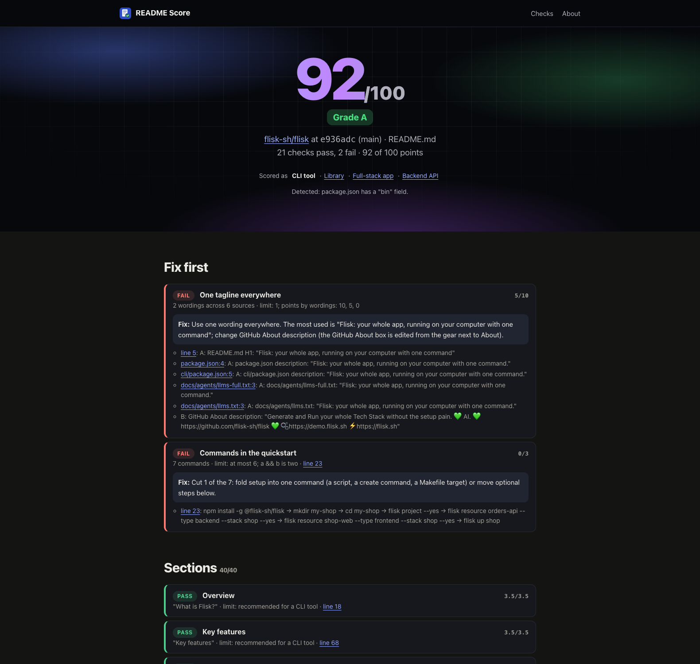

# README Score: your README, scored out of 100, with a fix for every miss



Enter a GitHub repository or paste a README, and get a score out of 100, the sections found and missing, and a fix for
each miss. It runs at [readme.flisk.si](https://readme.flisk.si/).

```bash
git clone https://github.com/flisk-sh/readme-score
cd readme-score/services/app/web
bun install
bun run dev
```

Then open http://localhost:4000/flisk-sh/flisk, or paste a README on http://localhost:4000/.

## What is README Score?

A README checker with no model in it. Every check is a fixed rule (a pattern, a count or a formula), so the same
README always gets the same score, and every finding names the line to change and how. It replaces AI README
reviews, whose score moves between runs and whose advice points at no line.

## Key features

- A score out of 100 and a grade, with the failing checks that cost the most points first.
- A line for every finding, linked to that line on GitHub at the commit that was scored.
- A concrete fix for every miss: the heading to add and where, the command to move, the link to correct.
- Weights for the kind of project: a CLI tool, a library, a full-stack app or a backend API.
- A comparison with the product's website: the same headline, and the words of the README's pitch, listed where they differ.
- A JSON API, a score badge and an MCP tool, none needing a key.

## What it checks

Seven groups, 100 points. A check with nothing to look at (a pasted README has no file tree) is left out, and the score
is the points earned over the points that count. [`/checks`](https://readme.flisk.si/checks) lists every threshold,
weight and synonym, read from the code that scores.

| Group | Points | What it looks at | From Flisk's scoreboard |
| --- | --- | --- | --- |
| Sections | 35 | Overview, key features, prerequisites, installation, usage, configuration, examples, troubleshooting, roadmap, contributing, license: headings matched against fixed synonym lists, weighted for a CLI tool, a library, a full-stack app or a backend API | new |
| First screen | 20 | A title within 5 non-empty lines, an install command within 40 lines, a picture within 20, at most 6 badges and 250 words before the first code block | `readme-first-screen` |
| Readability | 10 | Flesch reading ease of the prose: 60 or more for every point, 30 or less for none; the longest sentences and infrastructure words listed | `readme-readability` |
| Quickstart | 10 | One shell block that installs the project, at most 6 commands, and translated READMEs that give the same commands | `steps-to-first-healthy`, `translation-drift` |
| Links | 10 | Relative links that name a file in the repository with the right case, and #anchors that match a heading | `doc-links` |
| Tagline | 5 | One description in the README H1, the package manifests, llms.txt and the GitHub About box; one spelling of the name | `tagline-consistency`, plus name spelling |
| Website | 10 | The product's website (the repository's homepage, or `homepage` in package.json): its `<title>`, `og:title` or `<h1>` uses the README H1's wording, its meta description at least half the key words of the README's opening, and it leads with the README quickstart's first command and install command | new |

The checks are ported from the scoreboard in [flisk-sh/flisk](https://github.com/flisk-sh/flisk/tree/main/scripts/scores)
and generalised: any package manager's install command instead of Flisk's, any manifest instead of Flisk's two. The
thresholds are named constants in [`services/app/web/src/readme/`](services/app/web/src/readme).

## In your terminal and CI

```bash
npx @flisk-sh/readme-score                  # this folder
npx @flisk-sh/readme-score honojs/hono      # a public GitHub repository
npx @flisk-sh/readme-score --min-score 90 --markdown >> "$GITHUB_STEP_SUMMARY"
```

The same checks as the website, deterministic. Options: `--min-score <n>`, `--type cli|library|app|api`, `--no-website`,
`--json`, `--markdown`. Exit codes: 0 passed, 1 below `--min-score`, 2 a README could not be read. Source:
[`packages/readme-score`](packages/readme-score).

As a GitHub Action, the score appears on the job summary and the job fails below `min-score`:

```yaml
- uses: actions/checkout@v4
- uses: flisk-sh/readme-score@v1
  with:
    min-score: 90
```

Inputs: `path`, `min-score`, `type`, `website` (`false` leaves out the checks that read the product's website),
`version` (the npm package, pinned). Outputs: `score`, `grade`, `passed`, `report`.

## Prerequisites

- [Bun](https://bun.sh/) 1.2 or newer (`bun --version`). Nothing else: no database and no API key.
- For `flisk up` only: Docker, Tilt and the [Flisk CLI](https://github.com/flisk-sh/flisk).

## Installation

Clone it and install the one dependency (Hono), as at the top, then check the server answers:

```bash
curl -s http://localhost:4000/health
```

It prints `{"status":"ok","service":"readme-score"}`. The repository keeps the launch template's Flisk setup
(`.flisk/project.json`, `services/app/web/service.json`), so `flisk up` from the root runs it under Flisk as well.

## Usage

| Address | What it answers |
| --- | --- |
| `/<owner>/<repo>` | The result page for a public GitHub repository; `/tree/<branch>` after it for a branch, `?type=cli\|library\|app\|api` to score it as another kind of project |
| `POST /paste` | The result for a pasted README (the form on the home page), with an optional `website` to compare |
| `/api/score?repo=owner/repo` | The same report as JSON; `POST /api/score` with `{"readme": "…", "type": "cli", "website": "https://…"}` scores Markdown |
| `/badge/<owner>/<repo>.svg` | A badge with the score |
| `/mcp` | An MCP server (Streamable HTTP) with one tool, `score_readme` |

A repository is read at one commit with three GitHub API calls (the repository, the commit, the file tree); its files
come from raw.githubusercontent.com, which the API limit does not count. Results stay in memory for ten minutes.

## Configuration

All optional.

| Setting | Default | What it does |
| --- | --- | --- |
| `PORT` | 4000 | Where to listen (10000 on Render) |
| `PUBLIC_URL` | the request's own address | The address people use, for canonical links, the social card and the sitemap |
| `TRUST_PROXY` | `none` | `last-forwarded` on Render, `cloudflare` behind Cloudflare's proxy: which header names the client, for rate limits |
| `CALLS_PER_MINUTE` | 120 | Fresh GitHub reads, API and MCP calls per client per minute |
| `GITHUB_TOKEN` | none | Raises GitHub's limit for the server from 60 to 5,000 API calls an hour; a fine-grained token with no permissions is enough |

## Examples

- Result pages: [flisk-sh/flisk](https://readme.flisk.si/flisk-sh/flisk),
  [honojs/hono](https://readme.flisk.si/honojs/hono) as a library,
  [BurntSushi/ripgrep](https://readme.flisk.si/BurntSushi/ripgrep) as a CLI tool.
- The report as JSON, and the failing checks alone:

  ```bash
  curl -s 'http://localhost:4000/api/score?repo=flisk-sh/flisk' | jq '[.groups[].checks[] | select(.pass == false) | {title, line, fix}]'
  ```

- A pasted README, scored as a library:

  ```bash
  curl -s localhost:4000/api/score -H 'content-type: application/json' -d '{"readme": "# slugkit\n\nTurn titles into slugs.\n", "type": "library"}' | jq .score
  ```

- The badge in your own README: `[](https://readme.flisk.si/<owner>/<repo>)`
- From an AI assistant: `claude mcp add --transport http readme-score https://readme.flisk.si/mcp`, then ask it to score
  a repository.

## Troubleshooting

| You see | Fix |
| --- | --- |
| `This server has used up its GitHub API calls until …` | Set `GITHUB_TOKEN`, or wait for the time it names, or paste the README |
| `Failed to start server. Is port 4000 in use?` | Start it on another port: `PORT=4001 bun run dev` |
| `… has no README in .github/, the root or docs/` | GitHub shows no README for that repository either; paste one to score it |
| `Relative links resolve: not checked: GitHub sent part of the file tree` | The repository has too many files for one tree call; the other checks still run |

## Tests

```bash
cd services/app/web
bun run typecheck && bun run lint && bun test
```

Each check has unit tests on the fixture READMEs in [`tests/fixtures/`](services/app/web/tests/fixtures). To check the
port against the original, run Flisk's own scoreboard and this code on the same commit of flisk-sh/flisk:

```bash
# from services/app/web, with a flisk checkout next to this one
GITHUB_TOKEN=$(gh auth token) bun scripts/parity.ts --flisk ../../../../flisk --ref main
```

It exits 1 when the first-screen, readability or tagline results differ.

## Deploy

One free Render web service from [`render.yaml`](render.yaml), with readme.flisk.si as a CNAME on Cloudflare. The
steps, the token and Render's two-domain limit are in [DEPLOY.md](DEPLOY.md).

## Roadmap

- The how-it-works film: `video/film.json` describes it for this site. Start the app with `PORT=4177 bun src/index.ts`, then `bun run video` renders it (Chrome and
  ffmpeg); the home page shows it once `src/video.generated.ts` has it.
- Anchors into other files (`docs/guide.md#install`) are counted, not checked yet.
- The Product Hunt kit in [LAUNCH.md](LAUNCH.md) is still the template's, to fill in before launch.

## Contributing

Run the tests above and open a pull request. A new check is a pure function in `src/readme/`, its points in
`POINTS` in `score.ts`, a line on the checks page, and tests on a fixture README.

## License

MIT. See [LICENSE](LICENSE).
